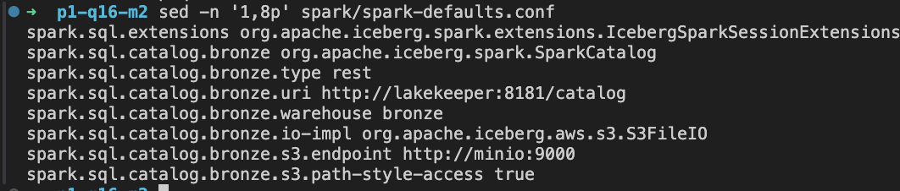
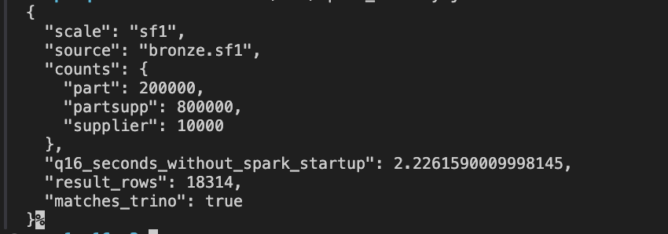

# Отчёт по практической работе №1

В работе реализована медальонная архитектура lakehouse для запроса TPC-H Q16 на масштабе SF1. Данные размещены в S3-совместимом хранилище, таблицы организованы в формате Apache Iceberg, а обработка выполнена через Trino и Spark. Результат Gold содержит 18 314 строк и полностью совпадает с результатом исходного запроса; Spark получил тот же ответ непосредственно из Bronze.

## 1. Вариант и масштаб

| Поле | Значение |
|---|---|
| ФИО | Васильев Павел Александрович |
| Вариант и запрос | Вариант 4 — Q16 |
| Масштаб | `sf1` |
| Компьютер | MacBook Air, Apple M2, 8 ГБ оперативной памяти, macOS |
| Почему выбран этот масштаб | SF1 позволяет выполнить соединения, фильтрацию, агрегацию и эксперименты со снимками на доступном ноутбуке. Для Q16 материализованы три необходимые таблицы, что ограничивает расход памяти и диска. Увеличение масштаба не требуется для демонстрации всех пунктов практической работы. |

SF1 обозначает масштаб исходного набора TPC-H. Физический размер выбранных трёх таблиц после записи в Parquet и сжатия измерен отдельно. В работе используется один масштаб во всех слоях и при сравнении кодеков.


## 2. Поднятые сервисы и причины выбора

| Сервис | Фактический образ или версия | Роль в стеке | Обоснование выбора |
|---|---|---|---|
| Silo, совместимый форк MinIO; сервис `minio` | `pgsty/silo:RELEASE.2026-09-03T13-18-01Z` | S3-совместимое объектное хранилище для файлов данных и метаданных Iceberg | Позволяет развернуть локальное объектное хранилище и читать одни и те же данные из Trino и Spark через S3 API. Веб-консоль помогает проверять бакеты и объекты. |
| PostgreSQL | `postgres:17` | Служебная БД каталога Lakekeeper | Даёт постоянное хранилище для состояния каталога. Отдельный Docker-том сохраняет его при остановке контейнеров. |
| Lakekeeper | `quay.io/lakekeeper/catalog:v0.14.0` | Iceberg REST Catalog, через который движки находят таблицы | Общий REST-каталог позволяет подключить несколько движков к одним таблицам и согласованно работать с их метаданными. |
| Trino | `trinodb/trino:476` | SQL-движок: генерирует TPC-H, создаёт таблицы Iceberg и выполняет Q16 | В одном движке доступны генератор TPC-H, Iceberg-коннектор и SQL для всех преобразований. Это упрощает проверку результата относительно исходного запроса. |
| Apache Spark | `apache/spark:3.5.3`, библиотеки Iceberg `1.7.1` | Дополнительный движок в Docker, читает Bronze напрямую | Позволяет проверить, что таблицы доступны второму движку через REST-каталог и S3, и сравнить весь результат Q16 с Trino. |
| Вспомогательный контейнер `tools` | `python:3.12-slim` | Инициализация каталога, проверка ответов, замеры и эксперимент со снимками | Автоматизирует повторяемые действия и сохраняет CSV/JSON с фактическими результатами. |
| `minio-init` и `migrate` | Образы Silo и Lakekeeper из этого стека | Создание бакетов и подготовка служебной БД | Выполняют первоначальную настройку; после успешного выполнения завершаются с кодом `0`. |

Постоянно работающие сервисы подтверждены в [списке контейнеров](artifacts/services.txt). Spark выполнялся одноразовой командой `docker compose run --rm spark`; его успешное завершение и результат сохранены в логе и JSON.

В Silo созданы бакеты `bronze`, `silver`, `gold`; в Lakekeeper — соответствующие warehouses. В Trino подключены одноимённые каталоги, а основные таблицы находятся в схеме `sf1` каждого каталога. Например, `bronze.sf1.part` означает каталог Bronze, схему SF1 и таблицу деталей.

DBeaver используется как SQL-клиент на macOS для подключения к Trino по адресу `localhost:8080`. Выбранный дополнительный инструмент по пункту 6.2 — Spark, запущенный в Docker.

### Скрипты развёртывания

Полная конфигурация сервисов, сетевого взаимодействия, томов, зависимостей и лимитов памяти приведена в [compose.yaml](compose.yaml). Файлы подключения Trino находятся в [catalog](catalog), настройки Spark — в [spark/spark-defaults.conf](spark/spark-defaults.conf).

Последовательность команд развёртывания и обработки:

```bash
# Подготовка SQL для SF1.
docker compose run --rm tools prepare

# Хранилище, служебная БД, миграция и REST-каталог.
docker compose up -d minio postgres lakekeeper

# Инициализация Lakekeeper и регистрация трёх warehouses.
docker compose run --rm tools init

# SQL-движок.
docker compose up -d trino

# Создание основных слоёв на первоначально пустом стенде.
docker compose exec -T trino trino --file /work/sql/01_bronze.sql
docker compose exec -T trino trino --file /work/sql/02_silver_gold.sql

# Проверки качества и полного совпадения результата.
docker compose exec -T trino trino --file /work/sql/05_quality.sql
docker compose run --rm tools verify

# Измерение основных таблиц.
docker compose exec -T trino trino --file /work/sql/04_measurements.sql

# Независимые копии Bronze с GZIP и ZSTD и замеры Q16.
docker compose exec -T trino trino --file /work/sql/03_compression.sql
docker compose run --rm tools benchmark --repeats 5

# Изменение схемы и восстановление в демонстрационной таблице Silver.
docker compose run --rm tools snapshots

# Библиотеки и чтение Bronze вторым движком.
bash scripts/download_jars.sh
docker compose stop trino
docker compose run --rm spark
docker compose start trino
```

Данные Silo и PostgreSQL сохраняются в Docker-томах. Результаты вспомогательных команд сохраняются в папке проекта `artifacts/sf1` через подключённый каталог. Подробное воспроизведение описано в [README.md](README.md).

## 3. Разбор запроса и необходимые данные

Q16 определяет количество уникальных поставщиков для каждой комбинации бренда, типа и размера детали после применения ограничений.

| Таблица TPC-H | Нужные колонки | Использование в запросе |
|---|---|---|
| `part` | `partkey`, `brand`, `type`, `size` | `partkey` используется для соединения с `partsupp`. По бренду, типу и размеру выполняются фильтрация и группировка; эти три поля входят в результат. |
| `partsupp` | `partkey`, `suppkey` | Связывает детали с поставщиками. По `suppkey` выполняются исключение поставщиков и `COUNT(DISTINCT ...)`. |
| `supplier` | `suppkey`, `comment` | Подзапрос выбирает поставщиков, комментарии которых соответствуют шаблону `%Customer%Complaints%`; их ключи исключаются из результата. |

Условия Q16:

- бренд детали отличается от `Brand#45`;
- тип детали не начинается с `MEDIUM POLISHED`;
- размер входит в набор `49, 14, 23, 45, 19, 3, 36, 9`;
- поставщик исключается, если его комментарий соответствует шаблону `%Customer%Complaints%`.

Одна строка Silver соответствует паре «деталь — поставщик». Один поставщик может поставлять несколько деталей одной группы, поэтому в Gold используется `COUNT(DISTINCT suppkey)`.

Исходный запрос для контрольного результата сохранён в [sql/q16_source.sql](sql/q16_source.sql). Преобразования в Silver и Gold находятся в [sql/02_silver_gold.sql](sql/02_silver_gold.sql). Gold читается с сортировкой `supplier_cnt DESC, brand, type, size`; порядок вывода задаётся запросом чтения.

## 4. Медальонная архитектура и решения по слоям

Путь данных: `tpch.sf1` → три исходные таблицы Bronze → отфильтрованные связи в Silver → агрегированная витрина Gold.

Табличный формат всех основных таблиц — **Apache Iceberg версии 2**, формат файлов — **Parquet**, сжатие — **ZSTD**, партиционирование не задано. Формат, свойства записи и DDL проверены через Trino и сохранены в [report_checks.json](artifacts/sf1/report_checks.json).

Parquet хранит данные по колонкам и поддерживает сжатие, поэтому подходит для аналитических запросов, читающих выбранные поля. В этой работе единый формат также позволяет использовать файлы обоим движкам. [Описание Apache Parquet](https://parquet.apache.org/docs/overview/)

Размеры ниже приведены в **MiB**, где `1 MiB = 1 048 576 байт`. Учтены активные файлы данных текущего снимка: `SUM(file_size_in_bytes)` из таблицы метаданных `$files` с условием `content = 0`. Метаданные Iceberg и файлы, относящиеся только к старым снимкам, в эти значения не включены. Полные значения в байтах и MiB сохранены в [layer_measurements.json](artifacts/sf1/layer_measurements.json).

### Bronze

В Bronze сохранены все исходные колонки трёх таблиц. Это позволяет проверить связи и при необходимости использовать дополнительные поля исходного набора.

| Таблица | Колонки | Строк | Вес, MiB | Формат файлов | Сжатие | Партиционирование | Обоснование |
|---|---|---:|---:|---|---|---|---|
| `bronze.sf1.part` | `partkey`, `name`, `mfgr`, `brand`, `type`, `size`, `container`, `retailprice`, `comment` | 200 000 | 4,1181 | Parquet | ZSTD | Нет | Сохранён полный справочник деталей; чтение нужных колонок возможно из Parquet. |
| `bronze.sf1.partsupp` | `partkey`, `suppkey`, `availqty`, `supplycost`, `comment` | 800 000 | 27,8511 | Parquet | ZSTD | Нет | Сохранены исходные связи деталей и поставщиков; общий кодек упрощает контрольный набор. |
| `bronze.sf1.supplier` | `suppkey`, `name`, `address`, `nationkey`, `phone`, `acctbal`, `comment` | 10 000 | 0,5092 | Parquet | ZSTD | Нет | Сохранён полный справочник, включая комментарии для исключения поставщиков. |

Суммарный размер основных таблиц Bronze — **34 056 004 байта, или 32,4783 MiB**. Таблицы занимают соответственно 1, 2 и 1 активный файл данных. При таком объёме дополнительные партиции могли бы увеличить число мелких файлов и служебные расходы. У Q16 также нет фильтра по времени, который задавал бы естественное разбиение по датам, поэтому для этого стенда выбран простой вариант без партиций.

Кодек задан в той же SQL-сессии перед созданием таблиц:

```sql
SET SESSION bronze.compression_codec = 'ZSTD';
CREATE TABLE bronze.sf1.part
WITH (format = 'PARQUET')
AS SELECT * FROM tpch.sf1.part;
```

Подтверждение количества строк:


### Silver

В Silver соединены `part` и `partsupp`, применены все ограничения Q16 и оставлены пять необходимых колонок. Таблица хранит ещё не агрегированные связи, из которых можно сформировать витрину.

| Таблица | Колонки | Строк | Вес, MiB | Формат файлов | Сжатие | Партиционирование | Обоснование |
|---|---|---:|---:|---|---|---|---|
| `silver.sf1.part_supplier_clean` | `partkey`, `suppkey`, `brand`, `type`, `size` | 118 274 | 0,5357 | Parquet | ZSTD | Нет | Исключены неподходящие строки и ненужные колонки; один небольшой файл не требует дополнительного разбиения. |

Проверки [sql/05_quality.sql](sql/05_quality.sql) дали следующие результаты:

| Проверка | Результат |
|---|---:|
| Строки Silver с NULL в любом из пяти полей | 0 |
| Повторяющиеся пары `partkey`, `suppkey` в Silver | 0 |
| Связи Bronze `partsupp`, у которых отсутствует деталь или поставщик | 0 |

Свойства записи Silver заданы командой `SET SESSION silver.compression_codec = 'ZSTD'` перед созданием таблицы.

### Gold

В Gold выполнена группировка Silver по `brand`, `type`, `size` и подсчитано число уникальных поставщиков каждой группы.

| Таблица | Колонки | Строк | Вес, MiB | Формат файлов | Сжатие | Партиционирование | Обоснование |
|---|---|---:|---:|---|---|---|---|
| `gold.sf1.q16_supplier_counts` | `brand`, `type`, `size`, `supplier_cnt` | 18 314 | 0,0391 | Parquet | ZSTD | Нет | Компактная готовая витрина; при чтении результата не требуется повторять соединения Bronze. |

Активный файл Gold занимает **41 042 байта**. Число строк 18 314 получено проверкой полного результата; отображаемая в DBeaver первая порция строк не используется как общий размер витрины.

Проверка `tools verify` подтвердила полное совпадение всех строк Gold с исходным Q16 на `tpch.sf1`. Результат сохранён в [verification.json](artifacts/sf1/verification.json), весь ответ Gold — в [q16_gold.csv](artifacts/sf1/q16_gold.csv).


## 5. Тесты производительности

Для сравнения созданы отдельные копии трёх исходных таблиц в схемах `bronze.sf1_gzip` и `bronze.sf1_zstd` через [sql/03_compression.sql](sql/03_compression.sql). В каждой схеме сохранены одинаковые исходные строки и колонки, формат Parquet и отсутствие партиций. Кодек назначался перед записью в той же сессии: `SET SESSION bronze.compression_codec = 'GZIP'` или `'ZSTD'`.

Основной слой `bronze.sf1` используется для контрольной цепочки Silver и Gold. Значения размера в сравнении относятся к отдельным экспериментальным копиям, а не ко всему бакету Bronze.

### Методика

1. Один ноутбук и один масштаб SF1; запрос Q16 выполнялся последовательно.
2. По два прогрева для каждого кодека, затем по пять измеряемых запусков.
3. Порядок GZIP/ZSTD чередовался между повторами.
4. В каждом запуске выполнялся полный Q16 по соответствующим таблицам Bronze, и все строки ответа сравнивались с эталоном.
5. Клиентское время измерялось от отправки SQL до получения полного ответа Trino. Оно включает ожидание выполнения, обмен по HTTP и получение всех 18 314 строк.
6. Во время этой серии Spark не выполнялся: его запуск зафиксирован в логе после завершения сравнения кодеков.

Измерения выполнены командой:

```bash
docker compose run --rm tools benchmark --repeats 5
```

### Итоги сравнения

| Сжатие Bronze | Медиана клиентского времени, с | Размер активных файлов трёх таблиц, MiB | Вывод |
|---|---:|---:|---|
| GZIP | 0,5580 | 29,4474 | Дал меньший физический размер в этом эксперименте; медиана времени также меньше. |
| ZSTD | 0,6006 | 32,4731 | Размер больше, а диапазон времени пересекается с GZIP; устойчивое преимущество по скорости не установлено. |

Полные размеры: GZIP — **30 877 797 байт**, ZSTD — **34 050 504 байта**. GZIP занимает примерно на **9,32%** меньше места относительно ZSTD. Вывод относится к этим данным, настройкам записи и реализации кодеков.

| Кодек | Минимальное клиентское время, с | Максимальное клиентское время, с | Медиана серверного `trino_elapsed_ms`, мс |
|---|---:|---:|---:|
| GZIP | 0,4948 | 0,6232 | 552 |
| ZSTD | 0,4761 | 0,6395 | 577 |

Серверное время приведено отдельной метрикой и не смешивается с клиентским. Разница клиентских медиан составляет около 0,0426 с, тогда как разброс внутри каждой серии больше этой разницы. Пять повторов дают основание описать наблюдаемое отличие, но недостаточны для вывода об устойчивом преимуществе одного кодека по скорости. Преимущество GZIP по размеру подтверждено непосредственно размерами файлов.

Основные слои сохраняют ZSTD как единый кодек исходной реализации. Для дальнейшей оптимизации хранения этого конкретного набора результат сравнения даёт основание рассмотреть GZIP.

Данные всех запусков, идентификаторы запросов и обе метрики времени сохранены в [benchmark_runs.csv](artifacts/sf1/benchmark_runs.csv); сводка — в [benchmark_summary.csv](artifacts/sf1/benchmark_summary.csv).


## 6. Осмысление и работа с инструментами

### 6.1. Lakehouse, изменение схемы и восстановление

| Вопрос | Ответ |
|---|---|
| Зачем нужны большие данные и lakehouse | При росте данных полезно разделить долговременное хранение файлов и вычислительные движки. В этом стенде S3-хранилище содержит данные, Iceberg организует их в таблицы, Lakekeeper предоставляет общий каталог, а Trino и Spark выполняют запросы. Слои Bronze, Silver и Gold отделяют исходные строки, подготовленные связи и результат агрегации. На выбранном небольшом SF1 обычная БД также могла бы выполнить Q16; lakehouse здесь позволяет изучить работу с открытыми форматами, несколькими движками и историей данных. |
| Что произошло при schema evolution на Silver | В демонстрационную таблицу добавлена nullable-колонка `note VARCHAR`, затем она переименована в `source_note`. Все 20 прежних строк сохранились, новая колонка у них читается как NULL. После переименования в текущей схеме есть `source_note`, а `note` отсутствует. |
| Как показаны time travel и восстановление | После удаления данных обычный COUNT вернул 0. Чтение сохранённого снимка через `FOR VERSION AS OF` вернуло 20. Затем `rollback_to_snapshot` вернул таблицу к этому снимку, и обычный COUNT снова показал 20. |

Iceberg отслеживает колонки по идентификаторам; добавление и переименование изменяют метаданные схемы и не требуют перезаписи файлов данных. Это позволяет читать прежние строки с новой схемой. [Документация Apache Iceberg об эволюции схемы](https://iceberg.apache.org/docs/1.7.1/evolution/)

Эксперимент выполнен на отдельной таблице Silver `silver.sf1.snapshot_demo_20261008205147`, содержащей 20 строк из `part_supplier_clean`. Основная таблица Silver сохраняет свои пять колонок и остаётся источником Gold.

Команды изменения схемы, выполненные скриптом:

```sql
ALTER TABLE silver.sf1.snapshot_demo_20261008205147
ADD COLUMN note VARCHAR;

ALTER TABLE silver.sf1.snapshot_demo_20261008205147
RENAME COLUMN note TO source_note;

SELECT COUNT(*) AS rows_with_null_note
FROM silver.sf1.snapshot_demo_20261008205147
WHERE source_note IS NULL;
-- Результат: 20.
```

Сохранённый идентификатор снимка: **4739065683946159628**. Последовательность удаления, исторического чтения и восстановления:

```sql
DELETE FROM silver.sf1.snapshot_demo_20261008205147;

SELECT COUNT(*)
FROM silver.sf1.snapshot_demo_20261008205147;
-- После удаления: 0.

SELECT COUNT(*)
FROM silver.sf1.snapshot_demo_20261008205147
FOR VERSION AS OF 4739065683946159628;
-- Из исторического снимка: 20.

ALTER TABLE silver.sf1.snapshot_demo_20261008205147
EXECUTE rollback_to_snapshot(4739065683946159628);

SELECT COUNT(*) AS rows_after_restore
FROM silver.sf1.snapshot_demo_20261008205147;
-- После восстановления: 20.
```

`FOR VERSION AS OF` читает выбранную историческую версию. `rollback_to_snapshot` меняет текущее состояние данных таблицы, после чего восстановленные строки доступны обычным SELECT. Снимок и относящиеся к нему файлы должны сохраняться; восстановление данных не следует считать автоматическим откатом всех изменений схемы. [Документация Trino 476 о снимках и восстановлении](https://trinodb.github.io/docs.trino.io/476/connector/iceberg.html#time-travel-queries)

| Этап эксперимента | Количество строк |
|---|---:|
| До удаления | 20 |
| После удаления | 0 |
| Чтение исторического снимка | 20 |
| После восстановления | 20 |

Результаты сохранены в [snapshot_demo.json](artifacts/sf1/snapshot_demo.json); конкретная команда восстановления — в [restore_snapshot.sql](artifacts/sf1/restore_snapshot.sql). Скрипт всего эксперимента находится в [scripts/lab_tools.py](scripts/lab_tools.py).


### 6.2. Подключение Spark к Bronze

| Инструмент | Почему выбран |
|---|---|
| Apache Spark 3.5.3 с Apache Iceberg 1.7.1 | Для задачи проверки совместимости удобно подключить второй движок, который читает те же таблицы через Iceberg REST Catalog и S3. Spark позволяет выполнить COUNT, показать строки Bronze и запустить тот же Q16 в одном скрипте. |

Spark развёрнут в Docker согласно сервису `spark` в [compose.yaml](compose.yaml). Подключение настроено в [spark/spark-defaults.conf](spark/spark-defaults.conf):

```text
spark.sql.catalog.bronze org.apache.iceberg.spark.SparkCatalog
spark.sql.catalog.bronze.type rest
spark.sql.catalog.bronze.uri http://lakekeeper:8181/catalog
spark.sql.catalog.bronze.warehouse bronze
spark.sql.catalog.bronze.io-impl org.apache.iceberg.aws.s3.S3FileIO
spark.sql.catalog.bronze.s3.endpoint http://minio:9000
spark.sql.catalog.bronze.s3.path-style-access true
```

Настройка `SparkCatalog` с типом `rest` подключает Iceberg-каталог по REST; `S3FileIO` обеспечивает доступ к файлам в объектном хранилище. Полная конфигурация содержит параметры региона и локального доступа, а также пути к двум библиотекам Iceberg. [Конфигурация Spark в документации Apache Iceberg](https://iceberg.apache.org/docs/1.7.1/spark-configuration/#catalogs)



Настройки подключения: REST-каталог Lakekeeper, warehouse `bronze`, `S3FileIO` и адрес Silo.

Действия в консоли:

1. Скачаны `iceberg-spark-runtime-3.5_2.12-1.7.1.jar` и `iceberg-aws-bundle-1.7.1.jar` через [scripts/download_jars.sh](scripts/download_jars.sh).
2. Trino остановлен командой `docker compose stop trino` для последовательного использования памяти ноутбука.
3. Выполнен `docker compose run --rm spark`. Скрипт [spark/read_bronze.py](spark/read_bronze.py) обратился к Lakekeeper и Silo напрямую.
4. Получены количества строк трёх таблиц Bronze и показаны первые десять деталей.
5. Q16 выполнен по `bronze.sf1`; весь ответ сравнен с сохранённым эталоном Trino.
6. После завершения Spark Trino снова запущен командой `docker compose start trino`.

| Проверка Spark | Результат |
|---|---|
| Источник | `bronze.sf1` |
| COUNT `part` | 200 000 |
| COUNT `partsupp` | 800 000 |
| COUNT `supplier` | 10 000 |
| Строк в результате Q16 | 18 314 |
| Полное совпадение с Trino | `matches_trino: true` |
| Время одного выполнения Q16 без запуска Spark, с | 2,2262 |
| Завершение приложения | Код `0` |



Результат сохранённого запуска Spark: источник `bronze.sf1`, количества строк трёх таблиц, 18 314 строк Q16 и `matches_trino: true`.

Подтверждения: [spark_summary.json](artifacts/sf1/spark_summary.json), [полный результат Spark](artifacts/sf1/spark_q16.csv), [выдержка с количеством строк и первыми деталями Bronze](artifacts/sf1/spark_console_excerpt.txt), [выдержка из выполненных команд](artifacts/console_excerpt.txt).

Этот запуск подтверждает чтение Bronze и одинаковый результат в двух движках. Время Spark относится к одному выполнению после контрольного чтения таблиц и не включает запуск JVM и SparkSession. Серия Trino использует другую методику прогрева и повторов, поэтому по этим числам нельзя сделать строгое сравнение скорости движков.

## 7. Выводы

Медальонная архитектура позволила сохранить исходные таблицы в Bronze, подготовить отфильтрованные связи в Silver и получить компактную витрину Q16 в Gold. На SF1 результат Gold полностью совпал с исходным запросом, а Spark получил те же 18 314 строк из общего Bronze, что подтвердило совместимость хранения и каталога с двумя движками. В эксперименте GZIP дал примерно на 9,32% меньший размер файлов, чем ZSTD, но разброс времени не позволяет уверенно объявить один кодек быстрее. Добавление и переименование колонки показали изменение схемы Iceberg, а удаление и восстановление 20 строк — практическую работу со снимками. Для MacBook Air с 8 ГБ памяти выбран SF1 и последовательный запуск Trino и Spark, что позволило выполнить все этапы без увеличения масштаба.

## Приложение с подтверждениями

| Пункт отчёта | Файл или скриншот |
|---|---|
| Конфигурация и воспроизведение | [compose.yaml](compose.yaml), [README.md](README.md) |
| Фактически работающие сервисы | [services.txt](artifacts/services.txt) |
| Выполненные команды и их результаты | [console_excerpt.txt](artifacts/console_excerpt.txt) |
| Bronze и количество строк | [Скриншот 23.40.40](<artifacts/screenshots/bronze-counts.png>) |
| Отсортированный Gold | [Скриншот 23.42.37](<artifacts/screenshots/gold-q16.png>) |
| Точные размеры и количества строк слоёв | [layer_measurements.json](artifacts/sf1/layer_measurements.json) |
| Серия замеров | [Скриншот 23.48.18](<artifacts/screenshots/codec-benchmark.png>) |
| CSV отдельных запусков | [benchmark_runs.csv](artifacts/sf1/benchmark_runs.csv) |
| CSV сводки | [benchmark_summary.csv](artifacts/sf1/benchmark_summary.csv) |
| Снимок и восстановление | [Скриншот 23.51.55](<artifacts/screenshots/snapshot-restore.png>), [snapshot_demo.json](artifacts/sf1/snapshot_demo.json) |
| Подключение Spark к Lakekeeper и S3 | [Скриншот подключения Spark](artifacts/screenshots/spark-connection.png) |
| Чтение Bronze и совпадение результата Spark с Trino | [Скриншот результата Spark](artifacts/screenshots/spark-verification.png) |
| Независимая повторная проверка результатов | [report_checks.json](artifacts/sf1/report_checks.json) |
